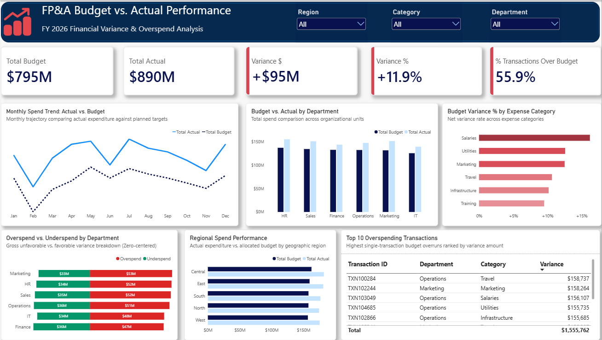

# FP&A Budget vs. Actual Dashboard (Power BI)

An interactive Power BI dashboard that analyzes **FY2026 budget vs. actual spend**, quantifies the variance, and pinpoints where overspending comes from across departments, expense categories, and regions.



---

## Business Question

> Where are we overspending relative to budget, how large is the gap, and is it driven by a few outliers or by a broad pattern?

## Key Findings

| Metric | Value |
|---|---|
| Total Budget | **$795M** |
| Total Actual | **$890M** |
| Variance ($) | **+$95M** |
| Variance (%) | **+11.9%** |
| Transactions over budget | **55.9%** |

1. **Spending ran 11.9% over budget** for the year, a $95M gap on a $795M budget.
2. **The overspend is systemic, not isolated.** Every department overspends more than it underspends. Gross overspend per department falls in a narrow band (about $47M to $53M), and no single department explains the gap. Gross overspend totals $303M against $208M of underspend, which nets to the $95M variance.
3. **More than half of all transactions (55.9%) exceed their budget.** This points to a budgeting or approval-control issue rather than a few large exceptions.
4. **The Top 10 overspending transactions total only $1.56M**, roughly 0.5% of gross overspend. Chasing individual outliers will not close the gap.
5. **Salaries has the highest variance %**, followed by Utilities and Marketing. Infrastructure and Training are the lowest.
6. **Operations appears repeatedly among the largest single-transaction overruns** (4 of the top 5 listed in the table).

## Recommendations

- Review the **budgeting baseline for Salaries and Utilities**, the two categories with the largest percentage overruns.
- Since the problem is broad, focus on **process controls** (approval thresholds, forecast refresh cadence) more than on individual transactions.
- Audit **Operations** spending, which shows up most often among the largest overruns.

## Dashboard Pages and Visuals

- **KPI cards:** Total Budget, Total Actual, Variance $, Variance %, % Transactions Over Budget
- **Monthly Spend Trend:** actual vs. budget by month
- **Budget vs. Actual by Department**
- **Budget Variance % by Expense Category**
- **Overspend vs. Underspend by Department:** zero-centered breakdown
- **Regional Spend Performance:** actual vs. allocated budget by region
- **Top 10 Overspending Transactions:** ranked by variance amount
- **Slicers:** Region, Category, Department

## Data

- **Source file:** [`data/Budget_vs_Actual_Data.xlsx`](data/Budget_vs_Actual_Data.xlsx)
- **Table:** `data`, 10,000 transaction rows, FY2026
- **Columns:** `Date`, `Department`, `Category`, `Region`, `Budget Amount`, `Actual Amount`, `Payment Method`, `Transaction_ID`

## DAX Measures

The metrics are implemented as DAX measures, organized into display folders. Most of them are in [`measures/budget_vs_actual_measures.tmdl`](measures/budget_vs_actual_measures.tmdl), which can be loaded through Power BI's TMDL view; the rest live in the `.pbix` file.

| Folder | Measures |
|---|---|
| 1 Core | Total Budget, Total Actual, Variance, Variance %, Budget Utilization %, Remaining Budget, Transaction Count, Avg Transaction Value |
| 2 Over and Under | Total Overspend, Total Underspend, Over Budget Transactions, % Transactions Over Budget, Avg Absolute Variance % |
| 3 Contribution | Variance Contribution %, Overspend Contribution % |
| 4 Formatting | Variance Status, Variance Color (conditional formatting) |
| 5 Time | Budget YTD, Actual YTD, Variance YTD, Variance % YTD, Actual Prior Month, Actual MoM Change, Actual MoM % |
| 6 Forecast | Months in Context, Avg Monthly Actual (Burn Rate), Projected Annual Actual |

Core logic:

```dax
Variance = [Total Actual] - [Total Budget]

Variance % = DIVIDE ( [Variance], [Total Budget] )

Total Overspend =
SUMX ( data, MAX ( data[Actual Amount] - data[Budget Amount], 0 ) )

Total Underspend =
SUMX ( data, MAX ( data[Budget Amount] - data[Actual Amount], 0 ) )

% Transactions Over Budget =
DIVIDE ( [Over Budget Transactions], COUNTROWS ( data ) )
```

Overspend and underspend are calculated **per transaction** and then summed, so they are not netted against each other. This is what makes the zero-centered Overspend vs. Underspend chart possible: the net of the two equals the total variance.

## Tools

Power BI Desktop, DAX, Power Query

## Repository Structure

```
├── FPA_Budget_vs_Actual_Dashboard.pbix
├── data/
│   └── Budget_vs_Actual_Data.xlsx
├── images/
│   └── dashboard.png
├── measures/
│   └── budget_vs_actual_measures.tmdl
└── README.md
```

## Author

**Rashad Alaa**
